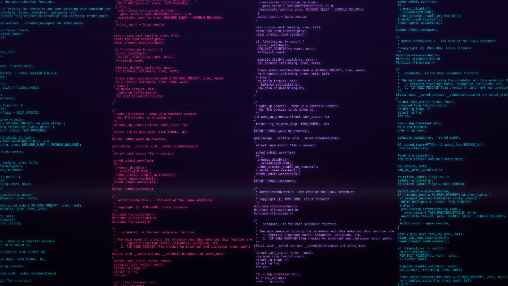

# Kernel Code — an Omarchy theme

A futuristic **techno-punk** reimagining of the classic WindowMaker
`kernel_code` theme: a full-screen wall of Linux kernel C source, rendered in
neon and glitch over a cyberpunk synthwave sky, with a green-phosphor terminal
palette for every themed app.



## Install

With [Omarchy](https://omarchy.org/):

```bash
omarchy theme install https://github.com/cirix/omarchy-kernel-code-theme
omarchy theme set kernel-code
```

`omarchy theme install` clones the repo into `~/.config/omarchy/themes/`, then
`omarchy theme set` applies it.

```bash
omarchy theme bg next   # cycle to the teal hue variant
```

## Contents

- `colors.toml` — green-phosphor palette that drives Neovim (aether), VS Code,
  Alacritty/Foot/Kitty/Ghostty, btop, Hyprland borders, and the Omarchy shell.
- `backgrounds/0-kernel-code.jpg` — neon cyan/pink/purple kernel code over a
  synthwave gradient with an outrun horizon glow, chromatic-aberration glitch,
  scanlines, and vignette (default).
- `backgrounds/1-kernel-code-teal.jpg` — cooler teal/blue hue variant.
- `icons.theme` — `Yaru-prussiangreen`.

The wallpapers render a representative `kernel/sched/core.c` scheduler snippet
in DejaVu Sans Mono, neon-tinted and bloomed, over a cyberpunk synthwave sky.

## Credits

Inspired by the original WindowMaker `kernel_code` theme. The rendered kernel
snippet is derived from the Linux kernel (`kernel/sched/core.c`, GPL-2.0).

## License

MIT — see [LICENSE](LICENSE).
